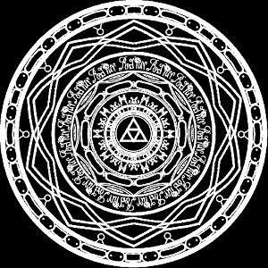

# The-Legend-of-a-Repository

# 📜 README.md

<p align="center">
  
</p>

## 📖 O Prólogo do Portal

> *Esta é apenas uma das muitas lendas das quais as pessoas falam...*

---

<p align="center">
Há muito tempo, nas vastas terras de Hyrule, um reino próspero e protegido pelas bênçãos dos Deuses, ergueu-se uma lenda. Uma lenda sobre uma Força Dourada, um Herói vestido de verde e uma linhagem real destinada a selar as trevas. 
<br><br>
🍃
<br><br>
Através das eras, este mundo mudou. Ele cruzou oceanos sem fim, testemunhou o crepúsculo engolir a luz, viu ilhas flutuarem acima das nuvens e presenciou reinos inteiros ruírem e renascerem sob o manto da destruição e da tecnologia ancestral.
<br><br>
⏳
<br><br>
O tempo passou, e as memórias daqueles feitos começaram a desaparecer da mente dos homens. As canções da Ocarina tornaram-se sussurros no vento, e as pinturas nas paredes dos templos tornaram-se poeira. A história corria o risco de ser esquecida...
<br><br>
⚔️
<br><br>
Para que os feitos do Herói do Tempo, do Herói dos Ventos, do Herói dos Céus e de tantos outros nunca sumissem no abismo do esquecimento, os guardiões desta era uniram-se. Eles ergueram um santuário digital. Um ponto de encontro para viajantes de todas as linhas temporais.
</p>

---

> *...E assim, o conhecimento foi preservado neste pergaminho.*

## 🏰 Sobre o Santuário (O Projeto)

Bem-vindo ao **[Hyrule Memorium]**, um refúgio forjado por fãs e para fãs da franquia **The Legend of Zelda**. Este site foi desenvolvido para celebrar cada era, cada masmorra e cada canção que moldou nossas jornadas pelos jogos da Nintendo.

### 🗺️ O que você encontrará nesta jornada:
* **Crônicas das Eras:** Conteúdos detalhados sobre múltiplos jogos da franquia.
* **Galeria dos Sábios:** Espaço dedicado à comunidade, e ao apreço pela história de Zelda.
* **Bússola do Viajante:** Guias, curiosidades e segredos escondidos por Hyrule.

## 🛠️ Ferramentas dos Sábios (Tecnologias)

Para erguer esta estrutura capazes de resistir ao avanço de Ganondorf, utilizamos os seguintes artefatos:

* 🔮 **Frontend:** HTML / CSS / JavaScript
* 🛡️ **Estilização:** CSS
* 📜 **Banco de Dados:** MySQL

## 🚀 Como Iniciar sua Própria Jornada

Se você deseja clonar este pergaminho e executá-lo em sua própria máquina local, siga os passos abaixo:

1. **Abra o seu terminal e clone este repositório:**
   ```bash
   git clone https://github.com
   ```

2. **Adentre a pasta do reino:**
   ```bash
   cd seu-repositorio
   ```

3. **Invoque as dependências necessárias:**
   ```bash
   npm install
   ```

4. **Desperte o servidor local:**
   ```bash
   npm run dev
   ```

---

<p align="center">
  <i>"Que a Triforça guie os seus passos."</i>
</p>
